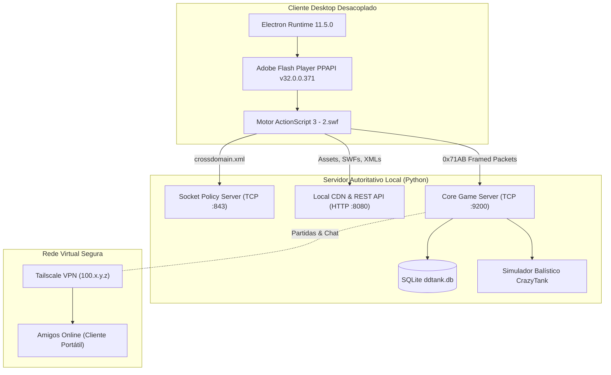

# Engenharia Reversa e Emulador do Servidor DDTank (DDClássico v2.0.5)

## 1. Visão Geral e Arquitetura do Sistema
Este documento consolida a especificação técnica e de engenharia reversa completa do cliente desktop `DDClassico.exe` (v2.0.5, engine 7Road DDTank), incluindo a reconstrução do servidor autoritativo local em Python, permitindo hospedar partidas multiplayer privadas entre amigos através da VPN virtual **Tailscale**.

---

## 2. Engenharia Reversa do Motor Flash (2.swf DoABC)
O núcleo de lógica do jogo foi recuperado a partir de `2.png` (disfarce binário para `2.swf`, 7.27 MB descomprimido), contendo 2.790 tags DoABC compiladas para a AVM2 (ActionScript Virtual Machine 2).

### 2.1. Estrutura do Pacote de Rede (Cabeçalho de 20 Bytes)
Todos os pacotes de rede utilizam framing estrito com o magic `0x71AB`:

| Offset | Tamanho | Tipo | Campo | Descrição |
|---|---|---|---|---|
| 0 | 2 B | `uint16` (BE) | `Magic` | Identificador constante `0x71AB` (29099) |
| 2 | 2 B | `uint16` (BE) | `TotalLength` | Comprimento total do pacote (20B cabeçalho + payload) |
| 4 | 2 B | `uint16` (BE) | `Checksum` | Algoritmo de integridade `(sum(bytes[6:]) + 119) & 0x7F7F` |
| 6 | 2 B | `int16` (BE) | `Opcode` | Código da mensagem (`ePackageType`) |
| 8 | 4 B | `int32` (BE) | `ClientID` | ID da sessão/jogador conectado |
| 12 | 4 B | `int32` (BE) | `Extend1` | Parâmetro auxiliar / Sala |
| 16 | 4 B | `int32` (BE) | `Extend2` | Parâmetro de roteamento |
| 20 | $N$ B | `bytes` | `Payload` | Dados da mensagem (primitivas BE ou ZLIB) |

### 2.2. Cifra de Fluxo Rolling XOR Simétrica (`DDTStreamCipher`)
A comunicação entre o cliente (`road7th.comm.ByteSocket`) e o servidor é protegida por uma cifra de fluxo simétrica com mutação de chave a cada byte transmitido:
- Chave inicial de 8 bytes: `[0xAE, 0xBF, 0x56, 0x78, 0xAB, 0xCD, 0xEF, 0xF1]`
- Mutação dinâmica:
  $$\text{key}[i \pmod 8] = ((\text{key}[i \pmod 8] + \text{prev\_cipher}) \bmod 256) \oplus i$$
- Cifragem:
  $$\text{cipher}[i] = ((\text{plain}[i] \oplus \text{key}[i \pmod 8]) + \text{prev\_cipher}) \bmod 256$$
- Decifragem:
  $$\text{plain}[i] = ((\text{cipher}[i] - \text{prev\_cipher}) \bmod 256) \oplus \text{key}[i \pmod 8]$$

---

## 3. Dissecação do Sistema de Inventário (Fase 3: `GRID_GOODS` Opcode 64)
A dissecação do método `PlayerManager::__updateInventorySlot` revelou que o payload do pacote `GRID_GOODS` é **obrigatoriamente comprimido com ZLIB**, sob pena de disparar `Error #2058` no ActionScript:

1. `pkg.deCompress()` descompacta o payload.
2. `bagType: int` (0 = Equipamentos/Armas, 1 = Consumíveis/Pedras, 11 = Cofre).
3. `itemCount: int` (número de slots a atualizar).
4. Para cada item:
   - `Place: int` (Slot 0-15 equipados, 31-79 mochila).
   - `isExist: bool` (se False, executa `bag.removeItemAt(place)`).
   - Se True: `UserID`, `ItemID`, `Count`, `Place`, `TemplateID`, `AttackCompose`, `DefendCompose`, `AgilityCompose`, `LuckCompose`, `StrengthenLevel`, `StrengthenExp`, `IsBinds`, `IsJudge`, `BeginDate` (7 bytes), `ValidDate`, `Color`, `Skin`, `IsUsed`, `Hole1..6`, `Pic`, `RefineryLevel`, `DiscolorValidDate` (7 bytes), `StrengthenTimes`, `Hole5Level`, `Hole5Exp`, `Hole6Level`, `Hole6Exp`, `isGold` (se True: `goldValidDate` + `goldBeginTime`), `latentEnergyCurStr`, `latentEnergyNewStr`, `latentEnergyEndTime` (7 bytes).

### 3.1. Arsenal VIP Autoritativo
O servidor injeta automaticamente no banco SQLite (`ddtank.db`) um arsenal lendário:
- **Arma Principal:** Super Bumerangue Dourado +12 (`TemplateID 7014`) com atributos quádruplos de composição +50.
- **Arma Secundária:** Verdadeiro Dom de Anjo +12 (`TemplateID 17002`) e Verdadeiro Escudo de Barok +12 (`TemplateID 17003`).
- **Vestuário Completo:** Coroa Real (`1142`), Armadura de Ouro Solar (`5101`), Traje Lendário (`13101`), Asas Flamejantes do Fênix (`15001`), Anéis da Felicidade +5 (`9022`), Braceletes de Vênus +5 (`9002`).
- **Mochila Extra:** Super Dom de Amor (`7015`), Super Quebra-Tijolos (`7004`), Super Lança do Trovão (`7008`), Super Canhão de Mão (`7001`), Super Fogos de Artifício (`7010`).
- **Consumíveis:** Pedras de Fortalecimento Nv. 5 x999, Amuletos da Sorte 25% x999, Símbolos dos Deuses x999 e Megafones.

---

## 4. Lobby, Salas e Chat com Comandos GM (Fase 4)
- **Gestor de Salas In-Memory:** Suporte a salas de Treino, PVP Livre (`MATCH_ROOM = 0`), Desafio de Equipes (`CHALLENGE_ROOM = 1`) e Instâncias PVE (`DUNGEON_ROOM = 4`).
- **Sincronização de Estado:** Subcódigos de `GAME_ROOM` (Opcode 94):
  - `GAME_ROOM_CREATE` (0)
  - `GAME_ROOM_LOGIN` (1)
  - `GAME_ROOM_SETUP_CHANGE` (2)
  - `GAME_ROOM_ADDPLAYER` (4)
  - `GAME_ROOM_REMOVEPLAYER` (5)
  - `GAME_TEAM` (6)
  - `ROOMLIST_UPDATE` (9)
  - `GAME_PLAYER_STATE_CHANGE` (15: Ready / Cancel)
- **Chat em Tempo Real & Comandos GM (Opcode 19: `SCENE_CHAT`):**
  - `/help`: Exibe catálogo de comandos disponíveis.
  - `/gold <qtd>`: Adiciona ouro instantaneamente.
  - `/money <qtd>`: Adiciona moedas/cash instantaneamente.
  - `/level <nv>`: Altera o nível do personagem (1 a 65).
  - `/item <template_id> [qtd]`: Entrega qualquer item diretamente na mochila via `GRID_GOODS`.

---

## 5. Motor Balístico CrazyTank e Física de Combate (Fase 5)
O módulo `scripts/ddt_combat_engine.py` replica fielmente a matemática de combate do DDTank:
1. **Fórmula de Crescimento de Fortalecimento (`StaticFormula`):**
   $$\text{Damage} = \text{Base} \times (1.1)^{\text{level}}$$
   Uma arma +12 atinge **$3.14\times$** o dano de uma arma base +0.
2. **Cálculo de Tiro Alto (High Throw / 65°):**
   $$\theta = 90^\circ - \text{Distância} \pm (\text{Vento} \times 2), \quad F = 95$$
3. **Cálculo de 60°:**
   $$\theta = 60^\circ \pm (\text{Vento} \times 2), \quad F = 10 + 3.1 \cdot d - 0.02 \cdot d^2$$
4. **Vetor de Trajetória 2D:**
   $$x(t) = x_0 + (v_0 \cos \theta + w \cdot k_w) \cdot t$$
   $$y(t) = y_0 - v_0 \sin \theta \cdot t + \frac{1}{2} g t^2$$

---

## 6. Distribuição para Amigos via Tailscale VPN (Fase 6)
O gerador [`scripts/build_friends_pack.py`](file:///C:/Users/dopamine/Desktop/Projetos/Reverse%20Engineering/scripts/build_friends_pack.py) empacota o cliente portátil desacoplado em `dist/DDTank_Multiplayer_Amigos.zip` (71.45 MB):
- Contém o runtime Electron 11.5.0 e Flash Pepper PPAPI v32.0.0.371.
- Contém o script `Jogar_Online.bat` com detecção de IP.
- Zero dependência de navegadores legados (Chrome antigo, Internet Explorer) ou Flash Player descontinuado.
- 100% livre de Themida, verificação de hashes Ed25519 e restrições de máquina.
